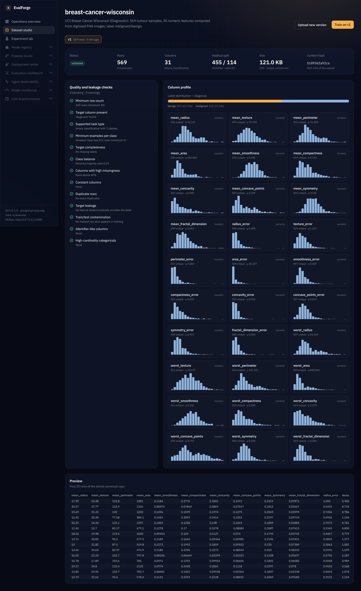
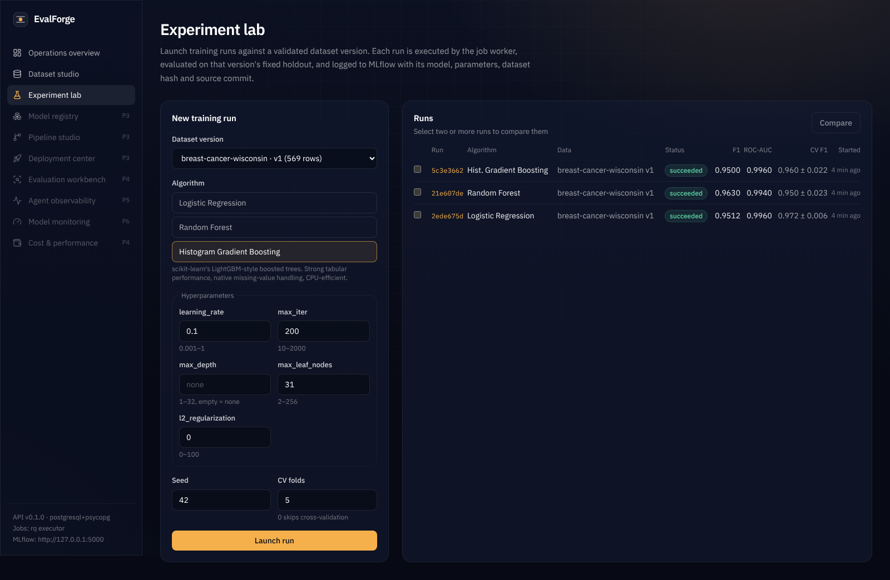
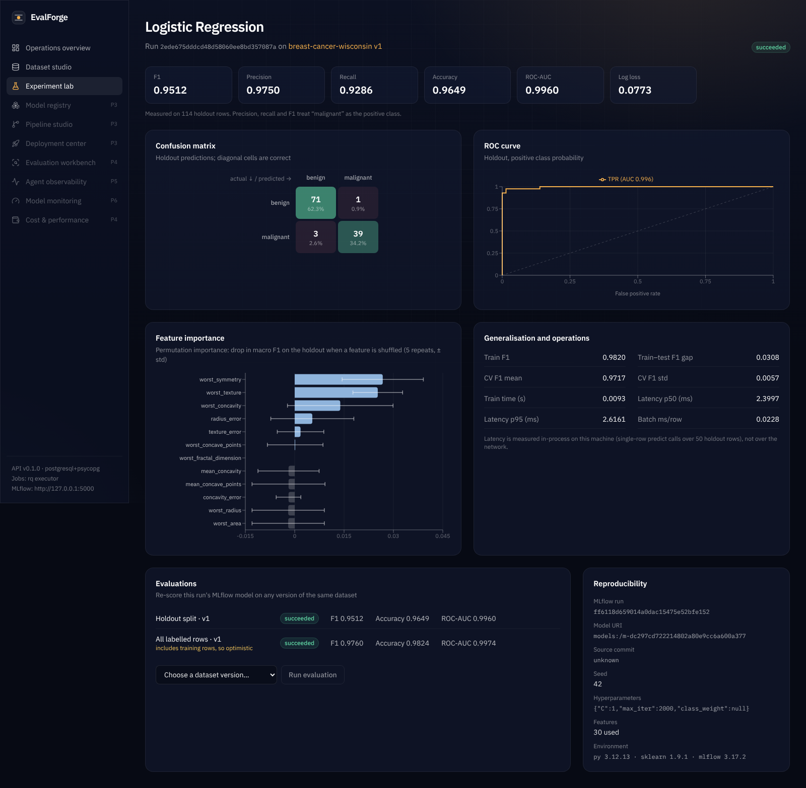
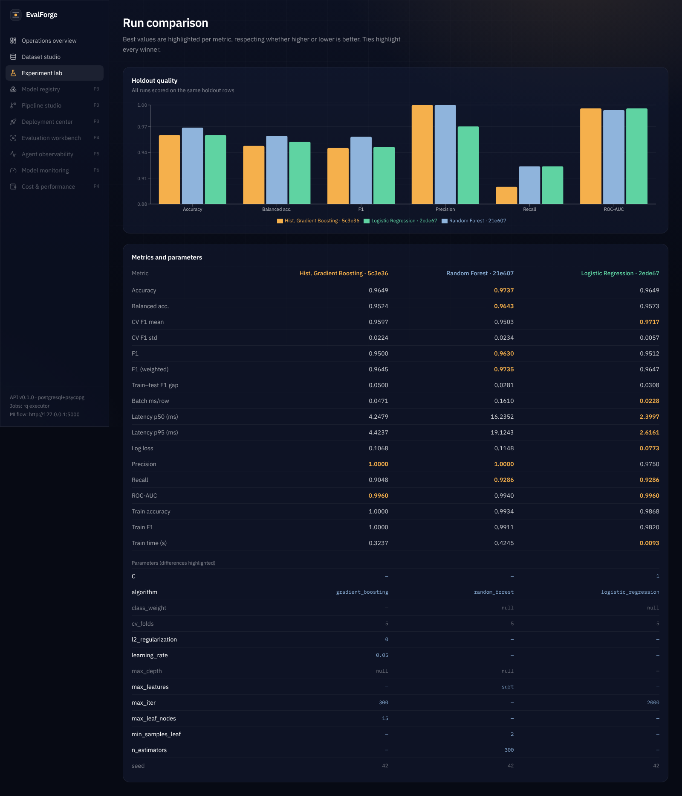

# EvalForge

A control center for the lifecycle of machine-learning models, LLM applications and AI
agents. You can register data, train and track models, evaluate them honestly and compare
them, and every number in the UI comes from a stored record.

> **Status:** Phase 2 of 9 is complete. The working vertical slice is
> **dataset upload → validation → training → MLflow tracking → evaluation → results dashboard**.
> Registry/deployment, LLM and agent evaluation, tracing, drift and retraining are designed
> ([architecture](docs/architecture.md)) but not yet built ([roadmap](docs/roadmap.md)).
> They show up in the navigation as planned modules, not as mock screens.

[](docs/media/evalforge-demo.mp4)

▶ **[Watch the 11-second demo](docs/media/evalforge-demo.mp4)** (1080p, recorded from the running app with the demo dataset and three real training runs).

## What works today

**Dataset studio**
- Upload CSV, JSON arrays or JSON Lines. Size, row and column limits apply, and files are never executed or unpickled.
- Every upload is stored as an immutable version, identified by its SHA-256 hash. Identical re-uploads are rejected, and a new version that drops or retypes columns is refused.
- Each version gets a profile: per-column type, missingness, histogram or top values, duplicates and label distribution.
- 13 quality and leakage checks run on every version, split into blocking checks and warnings. They cover target present and supported, class support and balance, high-missing, constant and identifier-like columns, features that encode the label, and train/test contamination.
- Each version gets a fixed stratified holdout split, persisted once and shared by every run on that version.

**Experiment lab**
- Three algorithms: logistic regression, random forest and histogram gradient boosting. Their hyperparameters are checked against typed schemas, and the form is generated from those schemas.
- Training runs in a background job, either a thread pool or Redis/RQ, with live stage, progress and logs. Failures are recorded with a traceback.
- Metrics depend on the task. Binary tasks use the positive label, multiclass tasks use macro averaging, and you also get ROC-AUC, log loss, train-test gap, optional stratified k-fold CV, permutation feature importance (± std) and measured inference latency.
- Each run is logged to MLflow with params, metrics, dataset input and hash, git commit, environment, diagnostics and the model. The model is saved with signature and input example, and serialised with skops rather than pickle.
- You can re-score a run's model, loaded back from MLflow, on any version of its dataset.
- The comparison view puts every metric side by side and highlights the best value, knowing for each metric whether higher or lower is better. Ties are shown, parameter differences are highlighted, and you get a warning when the compared runs did not share a holdout.

**Operations overview**
- A lifecycle line whose stages light up only when they hold real records.
- Best model per dataset, recent runs and the audit log.

## Measured results (Demonstration 1, Phase 2 part)

These results come from `make demo` on the UCI Breast Cancer Wisconsin (Diagnostic)
dataset, which is public (CC BY 4.0), has 569 rows and is bundled with scikit-learn. The
holdout is 114 rows, the positive class is *malignant*, CV is 5-fold on the training split
and the seed is 42. The run used PostgreSQL, an MLflow server and the Redis/RQ worker on a
Linux x86_64 dev container; raw output is in [docs/results/phase2-demo.json](docs/results/phase2-demo.json).

| Algorithm | F1 | Precision | Recall | ROC-AUC | Log loss | CV F1 (mean ± std) | Fit (s) | p50 latency (ms) |
|---|---|---|---|---|---|---|---|---|
| Logistic regression | 0.951 | 0.975 | 0.929 | 0.996 | **0.077** | **0.972 ± 0.006** | **0.009** | **2.4** |
| Random forest | **0.963** | 1.000 | 0.929 | 0.994 | 0.115 | 0.950 ± 0.023 | 0.42 | 16.2 |
| Hist. gradient boosting | 0.950 | 1.000 | 0.905 | 0.996 | 0.107 | 0.960 ± 0.022 | 0.32 | 4.2 |

How to read this: on a 114-row holdout, one misclassified malignant case moves recall by
about 0.024, so the holdout F1 differences between these models are within noise. The
cross-validated F1 and the log loss favour logistic regression, which is also the fastest
by an order of magnitude. That is why the comparison view shows CV and holdout
side by side instead of crowning a single "best". Two clean executions produced identical
quality metrics. Latency is measured in-process on the machine that ran the job.

## Quick start

### Lite profile: no Docker, about 450 MB RAM

Requires [uv](https://docs.astral.sh/uv/) and Node 20+.

```bash
make setup     # uv sync + npm ci
make dev       # API on :8000 (SQLite, embedded MLflow, in-process jobs) + web on :3000
```

Open http://localhost:3000 and choose **Load the breast-cancer demo dataset**. You can
also run the scripted demo against the running API:

```bash
make demo      # registers the dataset, trains 3 models, prints the comparison
make mlflow-ui # browse the same runs in MLflow on :5000
```

### Full profile: Docker Compose

```bash
cp .env.example .env   # optional
make compose-up        # postgres, redis, mlflow server, api, rq worker, web
```

This uses about 2.3 GB of memory limits in total, with no GPU and no Kubernetes. Services
bind to 127.0.0.1 only.

## Repository layout

```
backend/                FastAPI service (Python 3.11+, uv)
  evalforge/api/        HTTP routers: datasets, runs/evaluations/jobs, system
  evalforge/services/   ingestion, profiling & checks, storage, training, jobs, MLflow
  evalforge/ml/         algorithm catalogue + pipelines, metrics & diagnostics
  evalforge/migrations/ Alembic migrations (applied on start-up)
  evalforge/demo/       bundled public dataset + scripted demonstration
  tests/                unit + API integration tests (SQLite and PostgreSQL)
frontend/               Next.js 16, React 19, TypeScript, Tailwind v4, Recharts, Motion
docs/                   architecture, ADRs, roadmap, OpenAPI, results, screenshots
.github/workflows/      CI: lint, tests on SQLite + Postgres, migration drift, builds, security scans
docker-compose.yml      full profile
```

## Testing

```bash
make test                                    # pytest (20 tests) + TypeScript typecheck
EVALFORGE_TEST_DATABASE_URL=postgresql+psycopg://user@localhost/evalforge_test \
  uv run pytest tests/test_api.py            # same integration tests on PostgreSQL
```

The end-to-end test trains all three algorithms through the HTTP API and reads each run
back from MLflow, checking the tags, the dataset hash, the metrics and the dataset input.
It then evaluates a model reloaded from MLflow on a new dataset version.

## Design decisions

- [ADR 0001](docs/adr/0001-monorepo-fastapi-nextjs.md) — FastAPI + Next.js monorepo
- [ADR 0002](docs/adr/0002-mlflow-as-system-of-record.md) — MLflow is the system of record; registry via aliases; skops serialisation
- [ADR 0003](docs/adr/0003-job-execution.md) — pluggable executors (thread / RQ / sync) with job state in the DB
- [ADR 0004](docs/adr/0004-dataset-versioning.md) — content-addressed versions with fixed splits; DVC in Phase 3
- [ADR 0005](docs/adr/0005-lightweight-local-profile.md) — 8 GB laptop profile

## Security notes

There is no authentication yet. It arrives in Phase 3, so do not expose the API beyond
localhost. Uploads are parsed, never executed. Hyperparameters are validated against a
schema. Models are serialised with skops. Containers run as non-root. Audit events are
recorded for dataset and run lifecycle actions. See [architecture §6](docs/architecture.md#6-security-posture-current).

## Screenshots

| | |
|---|---|
|  |  |
|  |  |

## License

MIT. The demo dataset is UCI Breast Cancer Wisconsin (Diagnostic), CC BY 4.0.
