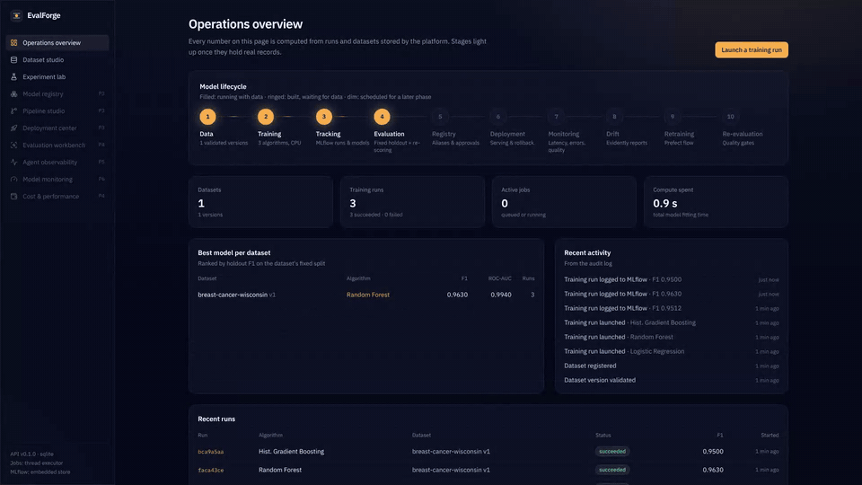
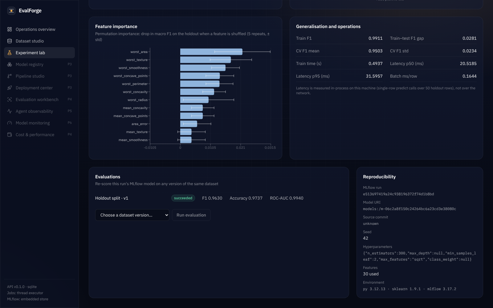
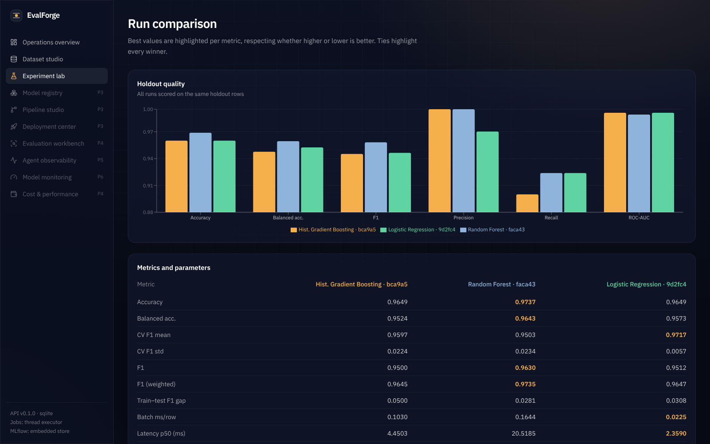
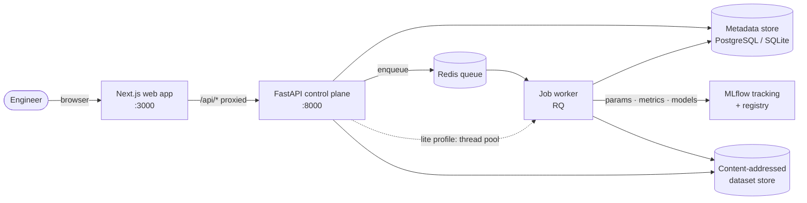
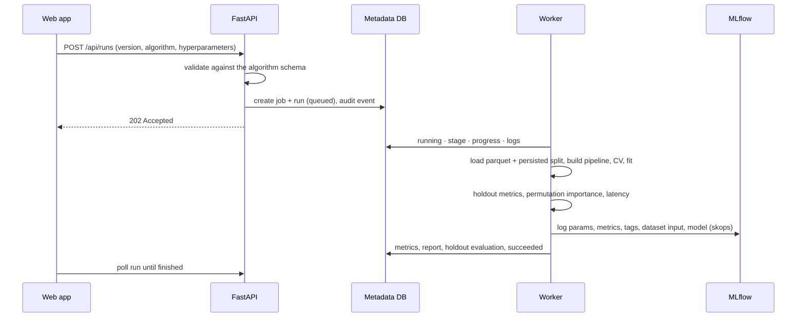

<div align="center">

# EvalForge

**An open control center for the full lifecycle of machine-learning models, LLM applications and AI agents: data, training, experiment tracking, evaluation, deployment and monitoring in one place, with every number traceable to a stored record.**

[](https://github.com/Singhsh01/EvalForge/actions/workflows/ci.yml)




<sub>11-second walkthrough recorded from the running app · <a href="docs/media/evalforge-demo.mp4">download the 1080p MP4</a></sub>

</div>

---

## Contents

- [Why EvalForge](#why-evalforge)
- [Project status](#project-status)
- [Features](#features)
- [Screenshots](#screenshots)
- [Measured results](#measured-results)
- [Architecture](#architecture)
- [How it works](#how-it-works)
- [Tech stack](#tech-stack)
- [Getting started](#getting-started)
- [API overview](#api-overview)
- [Testing and CI](#testing-and-ci)
- [Repository layout](#repository-layout)
- [Design decisions](#design-decisions)
- [Security](#security)
- [Roadmap](#roadmap)
- [Known limitations](#known-limitations)
- [License and data](#license-and-data)

---

## Why EvalForge

Teams that ship models usually stitch together a notebook, an experiment tracker, a few scripts and a dashboard. The usual result is metrics that can't be reproduced, comparisons made on different test sets, and no record of which data or code produced the model that's running.

EvalForge treats the lifecycle as one connected system:

```
Data → Training → Experiment tracking → Evaluation → Registry → Deployment → Monitoring → Drift → Retraining → Re-evaluation
```

For LLM and agent systems the same idea extends to prompts and agent runs:

```
Prompt versioning → Agent execution → Tracing → Evaluation → Comparison → Approval → Release → Production monitoring → Feedback
```

Three principles guide the build:

1. **Every number is traceable.** Metrics come from stored runs that point to an immutable dataset version (by SHA-256), a source commit, a seed and an MLflow run. Nothing on the dashboard is mocked.
2. **Comparisons are fair by construction.** All runs on a dataset version are scored on the same persisted holdout rows, and the UI warns when they aren't.
3. **It runs on a laptop.** The default profile needs no Docker and fits comfortably on an 8 GB Apple Silicon MacBook Air; heavier services are optional.

## Project status

EvalForge is built in nine phases. **Phases 1 and 2 are complete and verified.** Later modules appear in the app's navigation as planned items, never as placeholder screens.

| Phase | Scope | Status |
|---|---|---|
| 1 · Architecture | Architecture, data model, API contracts, security model, ADRs | ✅ Done |
| 2 · Vertical slice | Dataset upload → validation → training → MLflow tracking → evaluation → dashboard | ✅ Done |
| 3 · MLOps infrastructure | MLflow model registry (aliases), approvals, serving API, deploy/rollback, Prefect flows, DVC | ⏳ Next |
| 4 · AI evaluation | Claude + OpenAI-compatible providers, prompt versioning, deterministic / LLM-as-judge / RAG (Ragas) / agent evaluators, regression gates | Planned |
| 5 · Observability | OpenTelemetry traces, Prometheus metrics, Grafana, trace explorer, redaction | Planned |
| 6 · Drift and retraining | Evidently drift reports, alerts, incidents, approval-gated retraining | Planned |
| 7–9 · Frontend, verification, docs | Remaining modules, E2E suite, benchmarks, case studies | Planned |

Details and acceptance criteria are in [docs/roadmap.md](docs/roadmap.md).

## Features

### Dataset studio
- Upload **CSV, JSON arrays or JSON Lines** with enforced size, row and column limits. Files are parsed with pandas only, never executed or unpickled.
- Each upload becomes an **immutable, content-addressed version** (SHA-256). Re-uploading identical bytes returns `409`; a new version that drops or retypes columns returns `422`, so older models never silently break.
- An automatic **profile** per version: column types, missingness, histograms for numeric columns, top values for categorical ones, duplicate rows and label distribution.
- **13 quality and leakage checks**, split into *blocking* (the version can't be trained on) and *warnings*:

  | Check | Severity |
  |---|---|
  | Minimum row count · target column present · supported task type · minimum examples per class | blocking |
  | Target completeness · class balance · high missingness · constant columns · duplicate rows · **target leakage** (features that encode the label) · **train/test contamination** | warning |
  | Identifier-like columns (auto-excluded) · high-cardinality categoricals | info |

- A **fixed, stratified holdout split** (80/20, seed 42) persisted with each version, so every run on that version is evaluated on identical rows.

### Experiment lab
- Three algorithms: **logistic regression** (baseline), **random forest** and **histogram gradient boosting**. Each has a typed hyperparameter schema; the API rejects unknown keys or out-of-range values, and the UI form is generated from the same schema.
- Training runs as a **background job** with live stage, progress and log updates. Failures are recorded with their traceback instead of being lost.
- **Task-aware metrics:** accuracy, balanced accuracy, precision, recall, F1 (binary uses the positive label, multiclass uses macro averaging), ROC-AUC, log loss, train–test gap, optional stratified k-fold cross-validation, **permutation feature importance** with standard deviation, and measured inference latency (p50/p95).
- Everything is logged to **MLflow**: params, metrics, reproducibility tags (dataset hash, version, git commit, environment), the dataset as an MLflow input, diagnostics JSON and the model with signature and input example. Models are serialised with **skops** instead of pickle.
- **Re-evaluation:** load any run's model back from MLflow and score it on another version of the dataset.
- **Run comparison:** metrics side by side with the best value highlighted (knowing whether higher or lower is better, and showing ties), parameter differences, a grouped chart, and warnings when runs didn't share a holdout.

### Operations overview
- A lifecycle view where each stage lights up only once it holds real records.
- Best model per dataset, recent runs, run counts by status, total compute time and an activity feed from the audit log.

## Screenshots

All screenshots are 1600 × 1000 captures of the running application with the demo dataset and three real training runs.

<table>
  <tr>
    <td width="50%" valign="top">
      <br>
      <b>Operations overview</b><br>
      <sub>Lifecycle status, best model per dataset, audit-log activity and recent runs.</sub>
    </td>
    <td width="50%" valign="top">
      <br>
      <b>Dataset studio</b><br>
      <sub>Version summary, 13 quality and leakage checks, label distribution and per-column histograms.</sub>
    </td>
  </tr>
  <tr>
    <td width="50%" valign="top">
      <br>
      <b>Experiment lab</b><br>
      <sub>Schema-driven training form and the run table with holdout and cross-validated F1.</sub>
    </td>
    <td width="50%" valign="top">
      <br>
      <b>Run detail</b><br>
      <sub>Headline metrics, confusion matrix and ROC curve on the fixed holdout.</sub>
    </td>
  </tr>
  <tr>
    <td width="50%" valign="top">
      <br>
      <b>Diagnostics and reproducibility</b><br>
      <sub>Permutation importance, generalisation gap, latency, evaluations and MLflow lineage.</sub>
    </td>
    <td width="50%" valign="top">
      <br>
      <b>Run comparison</b><br>
      <sub>Grouped holdout metrics, best-per-metric highlighting and parameter differences.</sub>
    </td>
  </tr>
</table>

## Measured results

Demonstration 1 (Phase 2 part) on the **UCI Breast Cancer Wisconsin (Diagnostic)** dataset: public, CC BY 4.0, 569 rows and 30 numeric features, bundled with scikit-learn so no download is needed. The holdout is 114 rows, the positive class is *malignant*, CV is 5-fold on the training split and the seed is 42. The run used PostgreSQL, an MLflow server and a Redis/RQ worker; raw output is in [docs/results/phase2-demo.json](docs/results/phase2-demo.json).

| Algorithm | F1 | Precision | Recall | ROC-AUC | Log loss | CV F1 (mean ± std) | Fit (s) | p50 latency (ms) |
|---|---|---|---|---|---|---|---|---|
| Logistic regression | 0.951 | 0.975 | 0.929 | 0.996 | **0.077** | **0.972 ± 0.006** | **0.009** | **2.4** |
| Random forest | **0.963** | 1.000 | 0.929 | 0.994 | 0.115 | 0.950 ± 0.023 | 0.42 | 16.2 |
| Hist. gradient boosting | 0.950 | 1.000 | 0.905 | 0.996 | 0.107 | 0.960 ± 0.022 | 0.32 | 4.2 |

**How to read this.** On 114 holdout rows, one misclassified malignant case moves recall by about 0.024, so the holdout F1 differences are within noise. Cross-validated F1 and log loss favour logistic regression, which is also an order of magnitude faster. This is why EvalForge shows CV and holdout side by side instead of crowning a single winner. Two clean executions produced identical quality metrics. Latency is measured in-process on the machine that ran the job.

**An engineering finding along the way:** running random-forest *prediction* single-threaded (training still uses two threads) cut single-row p50 latency from 66.8 ms to 16.2 ms, because thread dispatch dominated tiny predict calls. See [ADR 0005](docs/adr/0005-lightweight-local-profile.md).

## Architecture



**Source-of-truth split:** MLflow owns run parameters, metrics and model artifacts. EvalForge's own database owns what MLflow doesn't model well: validated dataset versions with their checks and splits, job lifecycle, cross-version evaluations, approvals and the audit trail. Each side stores the other's ID, so a run can be traced in either direction.

Two runtime profiles run the same code:

| | Lite (`make dev`) | Full (`docker compose up`) |
|---|---|---|
| Metadata | SQLite (WAL) | PostgreSQL 16 |
| Experiment tracking | Embedded MLflow (SQLite + local artifacts) | MLflow server, Postgres store, served artifacts |
| Background jobs | In-process thread pool | Redis + RQ worker |
| Memory | ~450 MB | ~2.3 GB total container limits |
| Requires | `uv`, Node 20+ | Docker |

The full write-up, with data model and sequence diagrams, is in [docs/architecture.md](docs/architecture.md).

## How it works



- **Pipelines:** one scikit-learn `Pipeline` combines a `ColumnTransformer` (imputation, scaling where the model needs it, one-hot encoding with infrequent-category grouping) and the estimator. Preprocessing is fitted on the training split only and ships inside the logged model, so serving can't drift from training.
- **Feature selection** is automatic and recorded: the target, identifier-like columns and constant columns are excluded, with the reason stored on the run.
- **Failure handling:** a job never crashes silently. Errors and tracebacks are stored on the job and the run. With the thread executor, jobs interrupted by a restart are marked failed rather than left "running".

## Tech stack

| Layer | Technology | Why |
|---|---|---|
| API | FastAPI, Pydantic v2 | Typed contracts, automatic OpenAPI, async I/O |
| Persistence | SQLAlchemy 2, Alembic, PostgreSQL / SQLite | One schema across both profiles; migrations run on start-up and are checked for drift in CI |
| ML | scikit-learn, pandas, NumPy | CPU-friendly, reproducible tabular pipelines |
| Experiment tracking | MLflow 3 | System of record for runs and models; aliases for registry promotion |
| Model serialisation | skops (via MLflow) | Loading a model doesn't execute arbitrary pickled code |
| Jobs | RQ + Redis, or an in-process thread pool | Small and macOS-friendly; job state lives in the DB, so behaviour doesn't depend on the executor |
| Frontend | Next.js 16, React 19, TypeScript, Tailwind CSS v4 | App Router, typed API client, self-hosted fonts so offline builds work |
| Visualisation | Recharts, Motion | Confusion matrix, ROC, importance and comparison charts; motion that respects reduced-motion settings |
| Data fetching | TanStack Query | Polling while jobs run, caching otherwise |
| Delivery | Docker Compose, GitHub Actions | Reproducible full stack; CI covers lint, tests, migrations, builds and security scans |

Coming in later phases: Prefect, DVC, Evidently, OpenTelemetry, Prometheus/Grafana, LangGraph, Ragas and the Anthropic Claude API.

## Getting started

### Prerequisites
- **Lite profile:** [uv](https://docs.astral.sh/uv/) and Node.js 20+ (`brew install uv node` on macOS)
- **Full profile:** Docker Desktop

### Lite profile (recommended for laptops)

```bash
git clone https://github.com/Singhsh01/EvalForge.git
cd EvalForge
make setup     # uv sync + npm ci
make dev       # API on :8000 and web app on :3000
```

Open **http://localhost:3000** and click **Load the breast-cancer demo dataset**, then launch runs from the **Experiment lab**.

Without `make`, use two terminals:

```bash
# terminal 1
cd backend && uv sync && uv run uvicorn evalforge.main:app --port 8000
# terminal 2
cd frontend && npm ci && npm run build && npm start
```

Other useful commands:

```bash
make demo        # registers the dataset, trains 3 models and prints the comparison (API must be running)
make mlflow-ui   # browse the same runs in the MLflow UI on :5000
make test        # backend tests + frontend type check
```

### Full profile (Docker Compose)

```bash
cp .env.example .env    # optional
make compose-up         # postgres, redis, mlflow, api, worker, web
```

Services bind to `127.0.0.1` only. Every setting is documented in [.env.example](.env.example).

## API overview

Interactive docs run at `http://localhost:8000/docs`, and the full spec is in [docs/openapi.json](docs/openapi.json).

| Method | Endpoint | Purpose |
|---|---|---|
| `GET` | `/api/health`, `/api/health/ready` | Liveness; readiness of database and MLflow |
| `GET` | `/api/meta` | Version, executor and the algorithm catalogue with hyperparameter schemas |
| `GET` | `/api/overview` | Dashboard aggregates computed from stored records |
| `POST` | `/api/datasets` | Upload a file and register a dataset (creates v1) |
| `POST` | `/api/datasets/{id}/versions` | Upload a new version (deduplicated, schema-checked) |
| `GET` | `/api/datasets/{id}/versions/{v}` | Schema, profile, quality checks and split |
| `GET` | `/api/datasets/{id}/versions/{v}/preview` | First rows of the stored data |
| `POST` | `/api/runs` | Launch a training run (returns `202` with job and run) |
| `GET` | `/api/runs`, `/api/runs/{id}` | List runs; full run detail with report and job logs |
| `GET` | `/api/runs/compare?ids=…` | Compare 2–8 runs |
| `POST` | `/api/runs/{id}/evaluations` | Re-score a run's model on another dataset version |
| `GET` | `/api/jobs/{id}` | Job status, progress and logs |
| `POST` | `/api/demo/breast-cancer` | Register the bundled public demo dataset |

## Testing and CI

```bash
make test
# run the same integration tests against PostgreSQL
EVALFORGE_TEST_DATABASE_URL=postgresql+psycopg://user@localhost/evalforge_test \
  uv run pytest tests/test_api.py
```

- **20 backend tests**: profiling and leakage detection, deterministic stratified splits, hyperparameter validation, every algorithm on mixed-type data with missing values, the upload and versioning rules, failure recording and timezone handling.
- The **end-to-end test** trains all three algorithms through the HTTP API, then reads each run back from MLflow to check tags, dataset hash, metrics and dataset input. Finally it evaluates a model reloaded from MLflow on a new dataset version.
- **GitHub Actions** ([ci.yml](.github/workflows/ci.yml)): ruff lint and format, tests on SQLite and PostgreSQL, a check that the ORM and migrations agree, frontend type check and production build, pip-audit, bandit, npm audit, and container builds with a smoke test.

## Repository layout

```
backend/
  evalforge/api/          HTTP routers: datasets, runs/evaluations/jobs, system
  evalforge/services/     ingestion, profiling and checks, storage, training, jobs, MLflow
  evalforge/ml/           algorithm catalogue and pipelines, metrics and diagnostics
  evalforge/migrations/   Alembic migrations (applied on start-up)
  evalforge/demo/         bundled public dataset and scripted demonstration
  tests/                  unit and API integration tests
frontend/
  src/app/                overview, dataset studio, experiment lab, run detail, comparison
  src/components/         shell, charts, lifecycle line, UI primitives
  src/lib/                typed API client and formatting
docs/
  architecture.md         system design, data model, flows, planned phases
  adr/                    architecture decision records
  roadmap.md              phases and acceptance criteria with evidence
  results/                measured demo output
  screenshots/, media/    screenshots and demo video
infra/                    database initialisation for Compose
docker-compose.yml        full profile
Makefile                  developer commands
```

## Design decisions

| ADR | Decision |
|---|---|
| [0001](docs/adr/0001-monorepo-fastapi-nextjs.md) | FastAPI + Next.js monorepo; the browser only talks to Next, which proxies `/api` |
| [0002](docs/adr/0002-mlflow-as-system-of-record.md) | MLflow is the system of record for runs and models; the registry will use aliases (stages are deprecated); skops serialisation |
| [0003](docs/adr/0003-job-execution.md) | Pluggable executors (thread / RQ / sync) with job state stored in the database |
| [0004](docs/adr/0004-dataset-versioning.md) | Content-addressed dataset versions with fixed splits; DVC arrives in Phase 3 as the remote and pipeline layer |
| [0005](docs/adr/0005-lightweight-local-profile.md) | A profile that fits an 8 GB laptop: no GPU, no Kubernetes, one job at a time |

## Security

Already in place:
- uploads are parsed, never executed
- hyperparameters are validated against a schema
- models are serialised with skops
- dataset names are pattern-restricted, and storage paths are derived from server-generated IDs and hashes
- containers run as non-root, with ports bound to localhost
- dataset and run lifecycle actions are written to an audit log

**Not yet implemented:** authentication and role-based access control arrive in Phase 3. Until then, don't expose the API beyond localhost.

## Roadmap

- [x] Architecture, data model, API contracts and ADRs
- [x] Dataset ingestion, profiling, quality and leakage checks, versioning
- [x] Background training with MLflow tracking and skops models
- [x] Holdout and cross-version evaluation; run comparison
- [x] Dashboard: overview, dataset studio, experiment lab, run detail, comparison
- [ ] MLflow model registry with `champion` / `challenger` aliases and approval records
- [ ] Inference API with model-version selection, deployment records and rollback
- [ ] Prefect continuous-training flow and DVC remote
- [ ] LLM evaluation: provider abstraction, prompt versioning, LLM-as-judge with calibration, RAG metrics
- [ ] Agent evaluation and OpenTelemetry trace explorer
- [ ] Evidently drift monitoring, alerting and approval-gated retraining
- [ ] Authentication, RBAC and rate limiting

## Known limitations

- Classification only for now (binary, and multiclass with up to 50 classes).
- No authentication yet (see [Security](#security)).
- Latency figures are in-process measurements on the machine that ran the job, not network latency.
- The demo dataset is small (114 holdout rows), so metric differences between models are mostly within noise.

## License and data

Released under the [MIT License](LICENSE).

Demo data: *Breast Cancer Wisconsin (Diagnostic)*, W. Wolberg, O. Mangasarian, N. Street and W. Street, UCI Machine Learning Repository, [doi:10.24432/C5DW2B](https://doi.org/10.24432/C5DW2B), CC BY 4.0.
