<div align="center">

# EvalForge

**An AI engineering operations platform for the full lifecycle of ML models, LLM applications and AI agents: versioned data, governed training-to-production, evaluation, distributed tracing, drift monitoring, incidents, and an evidence-grounded MLOps Copilot. Every number on screen comes from a stored record.**

[](https://github.com/Singhsh01/EvalForge/actions/workflows/ci.yml)


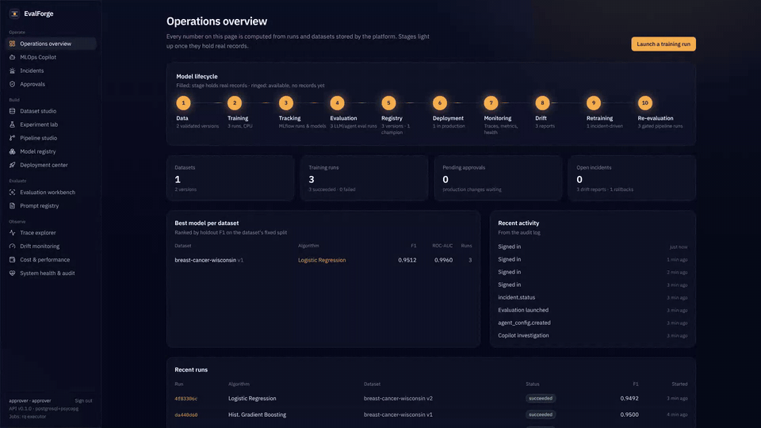

<sub>12-second walkthrough of the running app · <a href="docs/media/evalforge-enterprise-demo.mp4">1080p MP4</a></sub>

</div>

---

## Contents
[What it does](#what-it-does) · [Case studies](#case-studies-measured) · [Screenshots](#screenshots) · [Architecture](#architecture) · [Getting started](#getting-started) · [Feature status](#feature-status) · [Testing](#testing) · [Documentation](#documentation) · [Limitations](#known-limitations)

## What it does

| Module | What you can do | Backed by |
|---|---|---|
| **Dataset studio** | Upload CSV/JSON; immutable SHA-256 versions; profiles; 13 quality & leakage checks; fixed stratified holdout | pandas, Parquet |
| **Experiment lab** | Train logistic regression / random forest / histogram GBM with validated hyperparameters; CV, permutation importance, latency; compare runs | scikit-learn, MLflow |
| **Pipeline studio** | Continuous training as a live DAG: validate → train → evaluate → register → gate → staging → promotion request; retries, resume, lineage, schedules | persisted DAG runner |
| **Model registry** | MLflow registration, `champion` alias, quality gate that re-scores the champion on the candidate's holdout, model cards | MLflow registry |
| **Deployment center** | Staging/production, release health checks, canary traffic splits, promote/rollback, inference playground | versioned inference API |
| **Approvals** | Two-person control for promotion, production deploys, canary promotion, rollback, retraining, prompt release | role-based governance |
| **Evaluation workbench** | Versioned suites for prompts, RAG and agents; deterministic, schema, tool-use, retrieval, groundedness, citation and LLM-judge evaluators; regression detection | evaluation engine |
| **Prompt registry** | Templates with typed variables and JSON output schemas, diffs, evaluation-gated release | |
| **Trace explorer** | Distributed trace waterfall across API, worker, training, MLflow, inference, LLM and agent spans; redaction | OpenTelemetry |
| **Drift monitoring** | KS/χ²/PSI feature drift, prediction drift and label-confirmed degradation kept separate; PSI heatmap and distribution overlays | scipy |
| **Incident investigation** | Auto-opened from drift and eval regressions; timeline, Copilot findings, justified + approval-gated retraining | |
| **AI MLOps Copilot** | Ask *"Why did my latest model perform worse?"* — a tool-using agent gathers evidence from real data, and only claims citing that evidence survive | rules or LLM planner |
| **Cost & performance** | Quality vs latency, evaluation tokens/cost, serving latency | |
| **System health & audit** | Per-route latency/error rates, worker failures, retries, audit log, users | Prometheus metrics |

## Case studies (measured)

All three run end to end through the public API with separate *engineer* and *approver*
accounts (`make demo-enterprise`), on PostgreSQL + MLflow server + Redis/RQ. Raw output:
[`docs/results/enterprise-demo.json`](docs/results/enterprise-demo.json).

**1 · [Training to production with a canary and a rollback](docs/case-studies/01-ml-lifecycle.md).**
Public UCI breast-cancer data → pipeline → gate → approved promotion and production deploy
(holdout F1 0.951, CV F1 0.972 ± 0.006, p95 3.3 ms). A challenger passed the gate within
tolerance (Δ F1 −0.001) and went out as a 25 % canary: **101 of 400** requests reached it. It
was then rolled back under approval.

**2 · [An agent regression found by evaluation and explained by the Copilot](docs/case-studies/02-agent-regression.md).**
A Copilot config change ("trim tools to reduce latency") cut p95 latency from 149 to 58 ms. It
also dropped the agent suite's pass rate from **100 % to 60 %**. Regression detection opened an
incident, and the Copilot's investigation identified the removed tool with high confidence,
citing run and config IDs. The fixed config went back to 100 %.

**3 · [A production drift incident, diagnosed and resolved under approval](docs/case-studies/03-drift-incident.md).**
A synthetic scanner recalibration (+35 % on size features) dropped live F1 from **0.951 to
0.869** on 300 labelled samples, with PSI up to 2.29 on exactly the shifted features.
Retraining was justified only after labelled new data existed. The candidate beat the champion
on the same holdout (0.949 vs 0.922). After an approved release, F1 on recalibrated traffic was
**0.992**.

## Screenshots

<table>
<tr><td width="50%">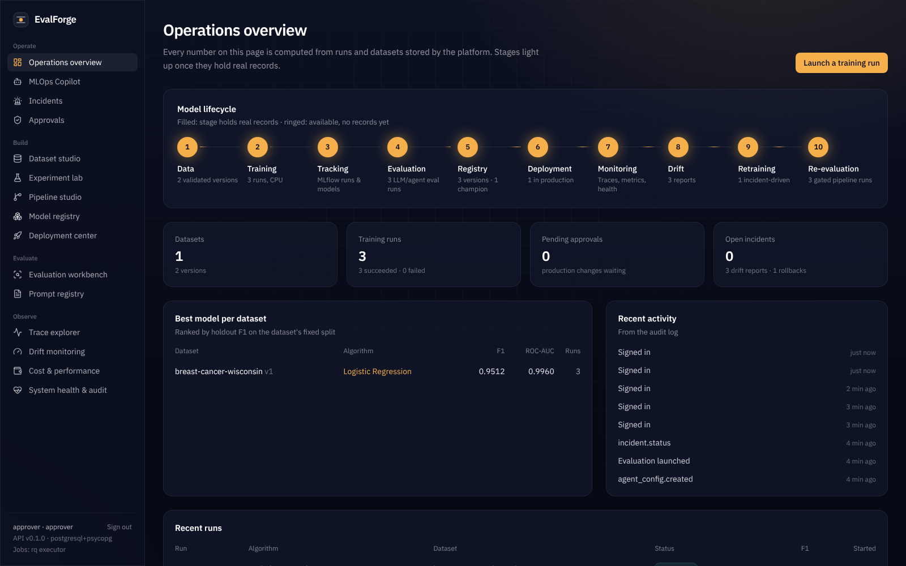<br><b>Operations overview</b> — lifecycle stages light up only when they hold records</td>
<td width="50%">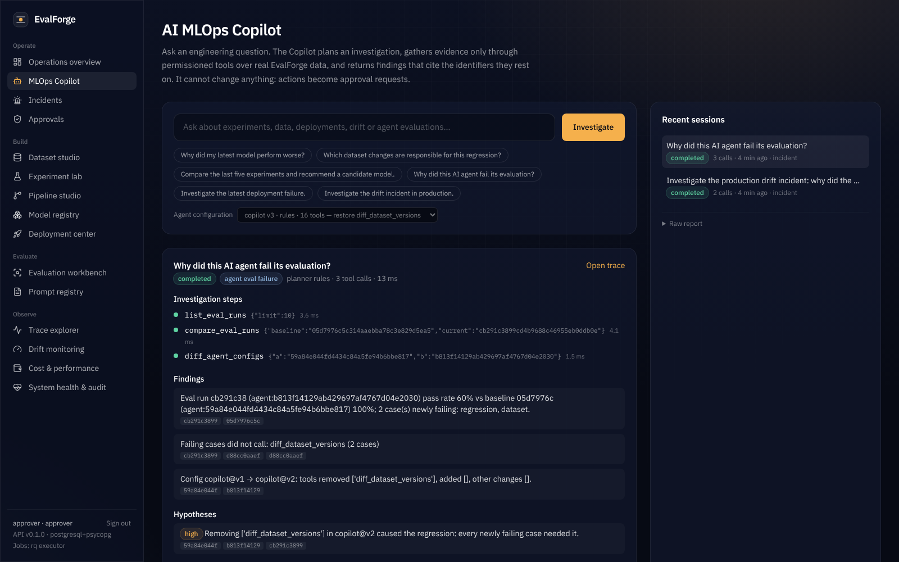<br><b>AI MLOps Copilot</b> — tool calls, cited findings, high-confidence hypothesis</td></tr>
<tr><td>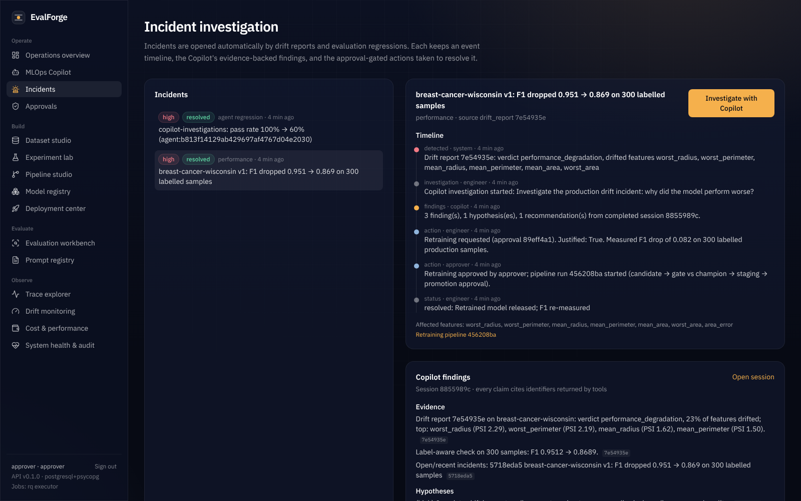<br><b>Incident investigation</b> — timeline, evidence, approval-gated retraining</td>
<td>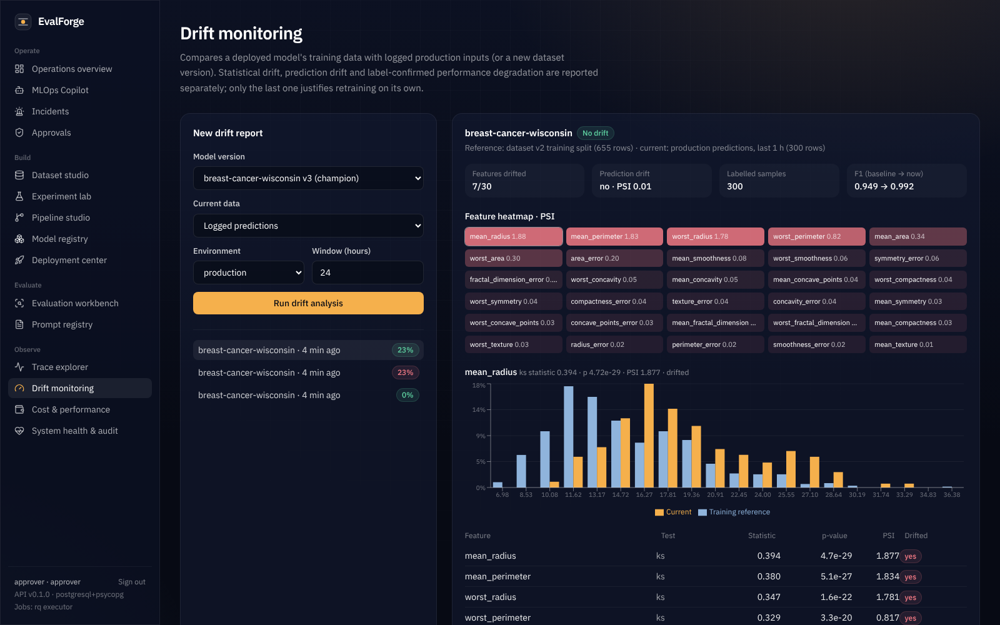<br><b>Drift monitoring</b> — PSI heatmap and reference vs current distributions</td></tr>
<tr><td>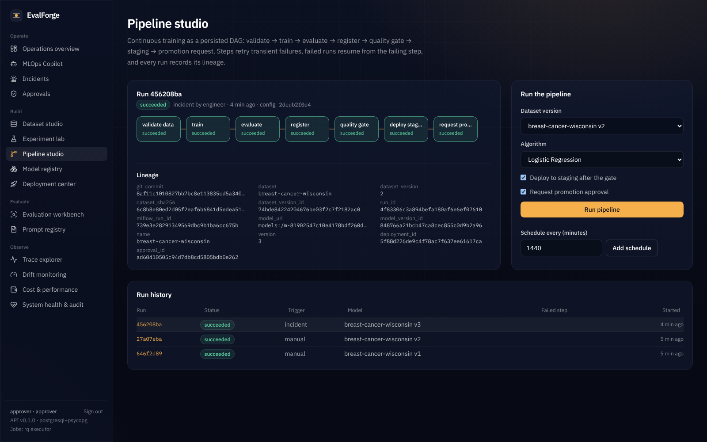<br><b>Pipeline studio</b> — live DAG state and lineage</td>
<td>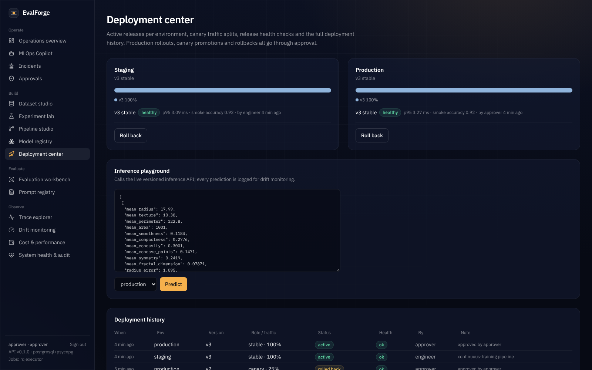<br><b>Deployment center</b> — environments, health, history, inference playground</td></tr>
<tr><td>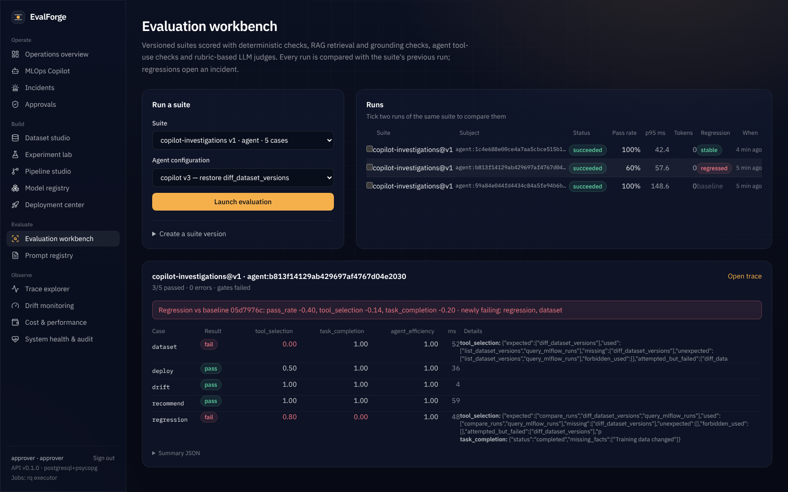<br><b>Evaluation workbench</b> — regression vs baseline with per-case evaluator details</td>
<td>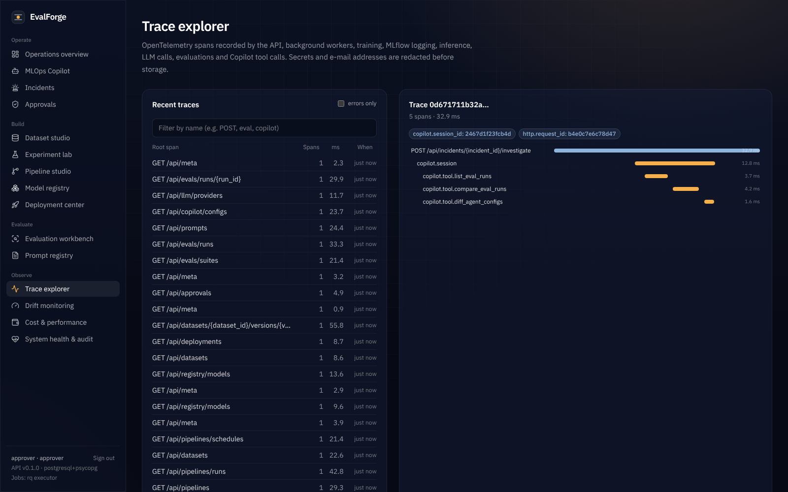<br><b>Trace explorer</b> — Copilot session waterfall</td></tr>
<tr><td>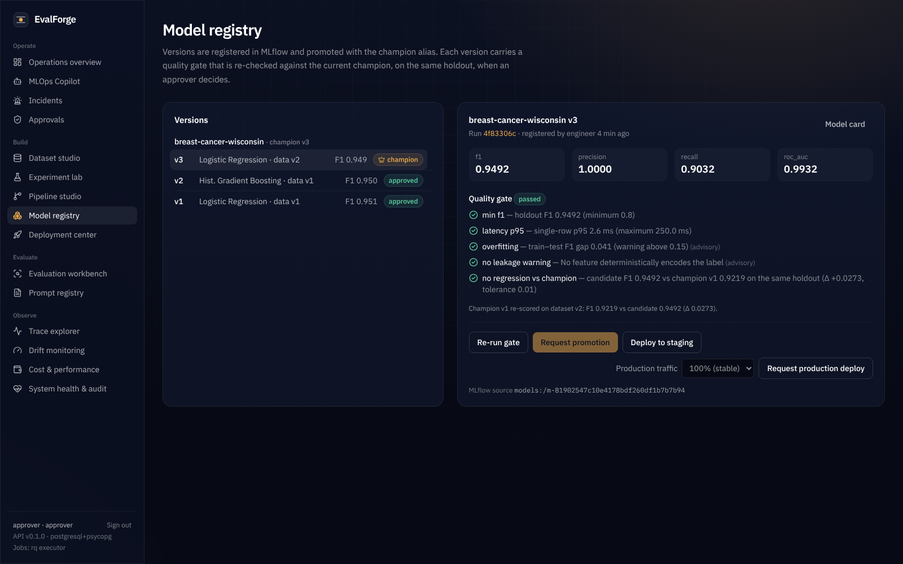<br><b>Model registry</b> — gate checks, champion alias, promotion</td>
<td>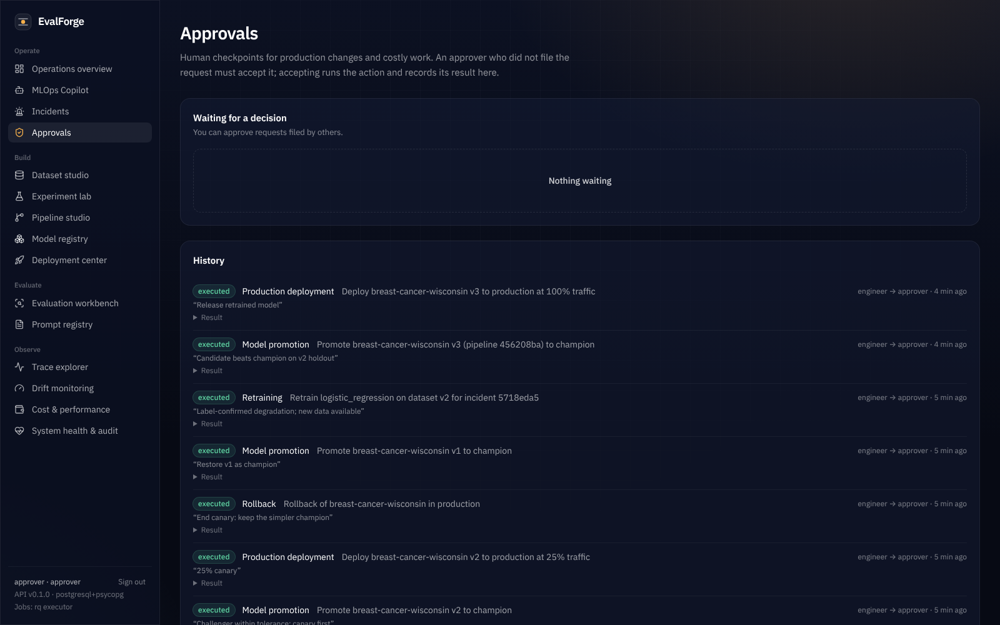<br><b>Approvals</b> — two-person control and decision history</td></tr>
<tr><td>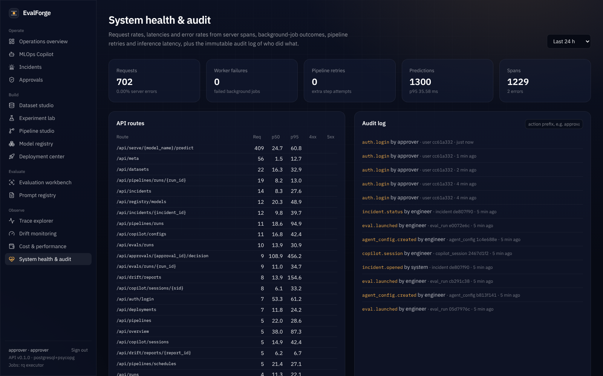<br><b>System health & audit</b></td>
<td>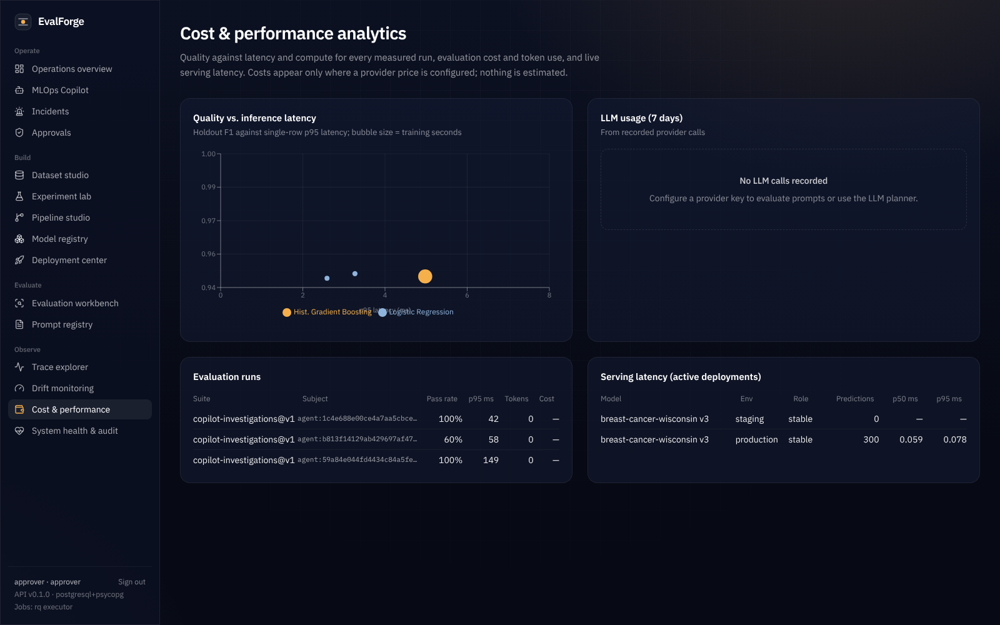<br><b>Cost & performance</b></td></tr>
</table>

## Architecture

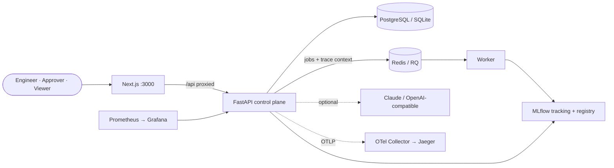

The core ideas:
- **MLflow is the system of record** for runs and models.
- **Governance and telemetry live in the platform database.**
- **Production changes are approvals**, executed only by a second person.
- **The Copilot can read but not act**: any action it wants becomes an approval request.

Full details: [docs/architecture.md](docs/architecture.md) and [ADRs 0001–0010](docs/adr).

## Getting started

**Lite profile** (no Docker, about 450 MB of RAM; needs [uv](https://docs.astral.sh/uv/) and Node 20+):
```bash
git clone https://github.com/Singhsh01/EvalForge.git && cd EvalForge
make setup      # uv sync + npm ci
make dev        # API :8000 (SQLite, embedded MLflow, thread executor) + web :3000
```
Open http://localhost:3000 and sign in. The first start creates four accounts: **admin**,
**engineer**, **approver** and **viewer**. Their password comes from
`EVALFORGE_BOOTSTRAP_PASSWORD`, which defaults to `evalforge-dev` in development. Then do one
of the following:
- In the browser, click *Load the breast-cancer demo dataset*.
- Run `make demo-enterprise` to reproduce all three case studies.

**Full profile:** `make compose-up` starts PostgreSQL, Redis, the MLflow server, the API, the
worker and the web app (about 2.3 GB of memory limits).
**Observability profile:** `make observability` adds the OTel Collector, Jaeger (:16686),
Prometheus (:9090) and Grafana (:3001).
**LLM features:** set `EVALFORGE_ANTHROPIC_API_KEY`, or an OpenAI-compatible
`EVALFORGE_OPENAI_BASE_URL` such as local Ollama.

All settings: [.env.example](.env.example).

## Feature status

Implemented features and their tests, plus what is still planned:
[docs/roadmap.md](docs/roadmap.md). In short:
- **Implemented and verified:** auth and RBAC, registry, gates, approvals, canary and rollback,
  pipelines, evaluation engine, tracing and metrics, drift and incidents, the Copilot, and all
  15 UI modules.
- **Implemented but not verified with a live LLM:** provider calls, prompt evaluations and the
  LLM judge, because no API key was available.
- **Deferred, with reasons in ADRs:** Prefect, DVC, Evidently, LangGraph, KServe, SSO.

## Testing

| Suite | Result |
|---|---|
| Backend: 55 tests (unit, API contract, integration, security, pipelines, LLMOps, observability, drift, Copilot) | ✅ SQLite · ✅ PostgreSQL |
| Lint (ruff), migration-drift check | ✅ |
| Frontend: type check and production build (19 routes) | ✅ |
| Browser end-to-end smoke (sign-in, 15 modules, live Copilot investigation, auth redirect) | ✅ |
| End-to-end case studies through the API (`enterprise_demo`) | ✅ full profile · ✅ lite profile |

Details and commands: [docs/results/test-report.md](docs/results/test-report.md).

## Documentation

| | |
|---|---|
| [Architecture](docs/architecture.md) · [ADRs](docs/adr) · [Roadmap / feature matrix](docs/roadmap.md) | design |
| [Deployment & rollback](docs/guides/deployment-and-rollback.md) · [MLOps pipelines](docs/guides/mlops-pipelines.md) · [Database migrations](docs/guides/database-migrations.md) | operate |
| [Evaluation methodology](docs/guides/evaluation-methodology.md) · [Copilot](docs/guides/copilot.md) · [Observability](docs/guides/observability.md) · [Security](docs/guides/security.md) | understand |
| [API reference](docs/guides/api-reference.md) (83 operations) · [OpenAPI](docs/openapi.json) | integrate |
| [Case studies](docs/case-studies) · [Measured results](docs/results) | evidence |

## Known limitations
- One API process runs the scheduler and the in-memory rate limiter. Running several replicas
  needs a leader lock and Redis-backed rate limits.
- Only classification models are supported, and serving runs in-process; there is no
  Kubernetes or KServe path.
- No real-LLM benchmark numbers are published, because none could be measured without a key.
- The Copilot's rules planner covers the documented question types. Free-form questions need
  the LLM planner.
- Docker images are built in CI but were not built during development, because Docker Hub was
  unreachable there.
- The demo data is small (114 holdout rows), so many metric differences are within noise. The
  case studies say where.

## License and data
MIT. Demo data: *Breast Cancer Wisconsin (Diagnostic)*, UCI Machine Learning Repository,
[doi:10.24432/C5DW2B](https://doi.org/10.24432/C5DW2B), CC BY 4.0. Drift scenarios are synthetic
and are labelled as such.
