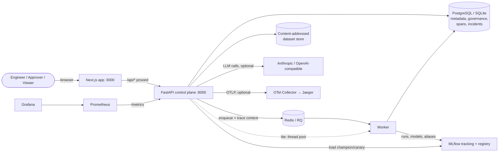
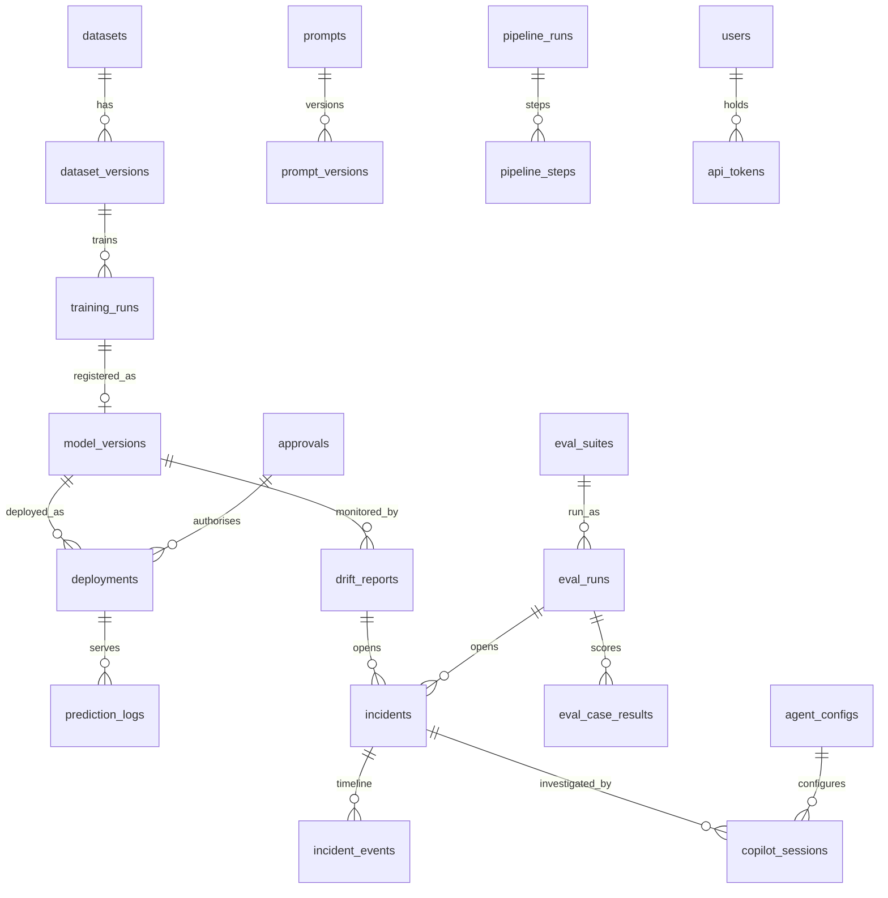
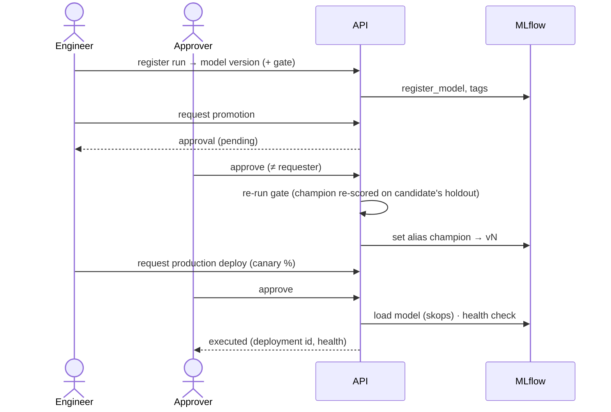

# EvalForge architecture

EvalForge is a single FastAPI control plane with a Next.js UI, a background worker, MLflow as
the system of record for runs and models, and a relational metadata store for everything MLflow
does not model: validated data versions, governance, deployments, evaluations, telemetry,
incidents and agent sessions.

## 1. System context

| | Lite (`make dev`) | Full (`make compose-up`) | + observability profile |
|---|---|---|---|
| Metadata | SQLite (WAL) | PostgreSQL 16 | |
| MLflow | embedded | MLflow server + Postgres | |
| Jobs | thread pool | Redis + RQ worker | |
| Telemetry | spans in DB, `/metrics` | same | + Collector, Jaeger, Prometheus, Grafana |
| Memory | ~450 MB | ~2.3 GB limits | + ~0.9 GB |

## 2. Modules

| Layer | Package | Responsibility |
|---|---|---|
| API | `api/auth, datasets, runs, ops, pipelines, llmops, monitoring, copilot, observability, system` | HTTP contracts, role checks |
| Governance | `services/auth`, `services/governance` | tokens, roles, rate limits, approvals with executors |
| ML lifecycle | `services/datasets, profiling, training, experiments, registry, serving, model_cache` | data versions, training, gates, deployments, inference |
| Orchestration | `services/jobs`, `services/pipelines` | executors (thread/RQ/sync), DAG runs, retries, resume, schedules |
| LLMOps | `llm/providers`, `llm/evaluators`, `services/evals` | provider abstraction, evaluators, suites, runs, regressions |
| Monitoring | `services/drift` | KS/χ²/PSI drift, prediction drift, label-aware performance, incidents, retraining plans |
| Agent | `copilot/tools`, `copilot/agent` | permissioned tools, planners, evidence validation, budgets |
| Telemetry | `observability/tracing`, `observability/metrics` | OTel spans → DB/OTLP with redaction; Prometheus |

## 3. Data model

Plus `jobs` (lifecycle of every background task), `evaluations` (re-scoring of ML runs),
`llm_calls`, `spans`, `pipeline_schedules` and `audit_events`. See
[database-migrations.md](guides/database-migrations.md).

## 4. Key flows

### Governed promotion and deployment

### Request → worker trace propagation
The API injects the W3C trace context into the job payload; the worker (thread or RQ process)
extracts it, so request, job, training, MLflow logging and pipeline-step spans share one trace.

### Drift → incident → controlled retraining
`drift report` (reference = training split, current = logged predictions since T) →
verdict (`no_drift` | statistical drift | `performance_degradation`) → incident → Copilot
investigation → retraining **plan** (justified only by label-confirmed degradation and newer
data) → approval → pipeline (`trigger: incident`) → gate vs champion → staging → promotion
approval → production approval → re-measure.

### Copilot investigation
plan (intent via rules or LLM) → tool calls (allow-list, budgets, spans) → analyse →
hypotheses → **validate citations against tool evidence** → report; actions only as approvals.

## 5. Design decisions
[ADR 0001–0010](adr): monorepo, MLflow as system of record, job execution, dataset versioning,
laptop profile, pipeline orchestration, drift statistics, Copilot agent, auth & governance,
observability.

## 6. Deliberate limitations
* One API process holds the scheduler loop and the in-memory rate limiter; multiple replicas need
  a leader lock and Redis-backed limits.
* Classification models only; the serving path runs in-process (no KServe/K8s).
* Span retention is unbounded; add a retention job for long-running installs.
* Real-LLM evaluation numbers require a provider key (none was available during development).
