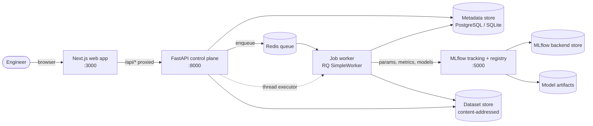
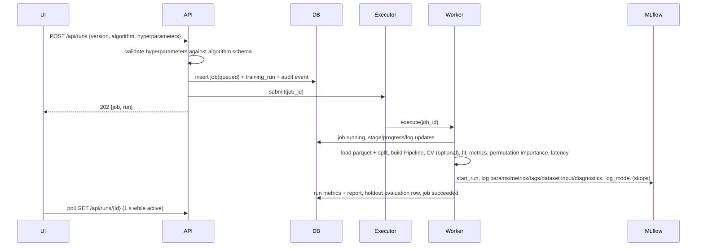

# EvalForge architecture

Status: Phase 1 (architecture) and Phase 2 (working vertical slice) are implemented and
verified. Later phases are designed here so the data model and boundaries don't need to
be re-cut, but they are not built yet — see [roadmap.md](roadmap.md).

## 1. System context



Two profiles run the same code:

| | Lite (`make dev`) | Full (`docker compose up`) |
|---|---|---|
| Metadata | SQLite (WAL) | PostgreSQL 16 |
| MLflow | Embedded SQLite store, local artifacts | MLflow server, Postgres store, served artifacts |
| Jobs | In-process thread pool (1 worker) | Redis + RQ worker process |
| Memory | ~450 MB (API + Next dev) | ~2.3 GB limits in total |
| Needs | `uv`, Node 20+ | Docker |

Both were exercised in verification: the test suite runs on SQLite with the synchronous
executor and against PostgreSQL; the demo evidence in `docs/results/phase2-demo.json` was
produced with Postgres + MLflow server + Redis/RQ.

## 2. Responsibilities and the source-of-truth split

| Concern | System of record | Why |
|---|---|---|
| Run params, metrics, model artifacts, model lineage, (Phase 3) registry aliases | **MLflow** | Industry-standard UI and APIs; no reason to re-implement |
| Dataset versions, profiles, quality checks, splits | **EvalForge DB** | MLflow datasets are references, not validated, versioned assets with checks |
| Job lifecycle (queued → running → succeeded/failed, progress, logs) | **EvalForge DB** | Must be identical across executors and survive worker restarts |
| Evaluations against other dataset versions, approvals, audit trail | **EvalForge DB** | Platform workflow state |

Every `training_runs` row stores `mlflow_run_id` and `model_uri`; every MLflow run carries
`evalforge.run_id`, `evalforge.dataset_version_id` and `evalforge.dataset_sha256` tags, so
either side can be joined to the other. The integration test asserts this round-trip.

## 3. Data model (Phase 2)

```mermaid
erDiagram
  datasets ||--o{ dataset_versions : has
  dataset_versions ||--o{ training_runs : "trained on"
  jobs ||--o| training_runs : executes
  training_runs ||--o{ evaluations : "scored by"
  dataset_versions ||--o{ evaluations : "scored on"
  jobs ||--o| evaluations : executes
  audit_events }o--|| datasets : "about any entity"

  datasets { string id PK; string name UK; string target_column }
  dataset_versions { string id PK; int version; string sha256; enum status; json schema; json profile; json quality_checks; json split }
  jobs { string id PK; enum kind; enum status; string stage; float progress; json logs }
  training_runs { string id PK; string algorithm; json hyperparameters; int seed; json metrics; json report; string mlflow_run_id; string model_uri; string git_commit }
  evaluations { string id PK; string split; json metrics; json report }
  audit_events { string id PK; string action; string entity_type; string entity_id; json data }
```

Key invariants:

* `(dataset_id, version)` and `(dataset_id, sha256)` are unique: identical bytes are never
  stored twice, and version numbers are monotonic.
* A version is `validated` or `rejected` at creation and never changes. Rejected versions
  stay visible (with their failing checks) but cannot be trained on.
* New versions must keep the target and all previous columns with the same kinds; added
  columns are allowed. This prevents a model trained on v1 silently breaking on v2.
* The holdout split is created once per version (stratified, seed 42, 20%) and persisted as
  `split.npz`. All runs on a version are therefore evaluated on identical rows, which is
  what makes comparison honest. The compare endpoint warns when runs span versions.

Schema changes go through Alembic (`evalforge/migrations`); the API upgrades to head on
start-up, and CI fails if the ORM and the migrations drift.

## 4. Request and job flow — training



Failure handling: `execute()` never raises. Exceptions are recorded on the job (message +
truncated traceback) and on the run/evaluation. With the thread executor, jobs that were
running when the API stopped are marked failed on next start-up instead of staying
"running" forever. RQ jobs get a hard timeout (`EVALFORGE_JOB_TIMEOUT_SECONDS`).

## 5. ML pipeline design

* One scikit-learn `Pipeline` = `ColumnTransformer` (median-impute + optional scaling for
  numeric; most-frequent impute + one-hot with infrequent-category grouping for
  categorical) + estimator. Preprocessing is fitted on the training split only and shipped
  inside the logged model, so serving cannot drift from training.
* Algorithms: logistic regression (baseline), random forest, histogram gradient boosting.
  Hyperparameters are validated against a typed schema (type, range, choices); unknown keys
  are rejected, so no arbitrary kwargs reach scikit-learn. The frontend form is generated
  from the same schema (`GET /api/meta`).
* Feature selection is automatic and recorded: target, identifier-like and constant columns
  are dropped with reasons stored on the run.
* Metrics are task-aware: binary metrics use the positive label (second label in sorted
  order, shown in the UI); multiclass uses macro averaging and one-vs-rest ROC-AUC.
  Reported alongside: train metrics and the generalisation gap, optional stratified
  k-fold CV on the training split, permutation importance on the holdout (model-agnostic,
  with std), and measured in-process latency.
* Models are serialised with **skops** through MLflow (`serialization_format="skops"`),
  so loading a model does not execute pickled code. Evaluation jobs load the model back
  from MLflow rather than from memory, which exercises the real artifact path.

## 6. Security posture (current)

* Uploads: extension allow-list (CSV/JSON/JSONL), size limit enforced while reading, row
  and column limits, duplicate-column rejection; parsed with pandas only — never
  evaluated, never unpickled. Dataset names are pattern-restricted (they become paths and
  MLflow experiment names); storage paths are derived from server-generated ids and hashes.
* Hyperparameters: schema-validated, no pass-through.
* Containers run as non-root; ports bind to 127.0.0.1 in compose.
* Audit events for dataset creation/versioning and run launch/completion.
* **Not yet implemented** (Phase 3+): authentication and RBAC, rate limiting, secret
  storage for LLM provider keys, trace redaction, approval gates. The API must not be
  exposed beyond localhost until authentication lands.

## 7. Planned architecture for later phases

| Phase | Additions | Boundary decisions already made |
|---|---|---|
| 3 MLOps infra | DVC remote for dataset files; Prefect flows wrapping the existing job handlers; MLflow registry with `champion`/`challenger` **aliases** (stages are deprecated); approval records; FastAPI serving endpoint loading `models:/<name>@champion`; deployment + rollback records | Job handlers are plain functions taking a job id, so Prefect tasks can call them unchanged |
| 4 AI evaluation | Provider abstraction (Anthropic + OpenAI-compatible), prompt templates + versions, eval datasets of cases, deterministic / LLM-judge / RAG (Ragas) / agent evaluators, quality gates | Evaluations are already a separate table keyed by (subject, dataset version); LLM evals become another subject type |
| 5 Observability | OpenTelemetry SDK in API and worker, OTel Collector, Prometheus metrics endpoint, Grafana dashboards, trace explorer UI, configurable redaction | Request-id middleware and `server-timing` headers exist; job logs are structured |
| 6 Drift & retraining | Evidently reports against a version's training reference; prediction logging from serving; alert rules and incidents; Prefect retraining flow ending in an approval request, never auto-deploy | Schema-compatibility rule between versions is what makes reference/current comparison valid |
| 7 Frontend | Registry, deployment, pipeline (React Flow), evaluation workbench, trace waterfall, monitoring screens | Modules already reserved in navigation with their phase |
